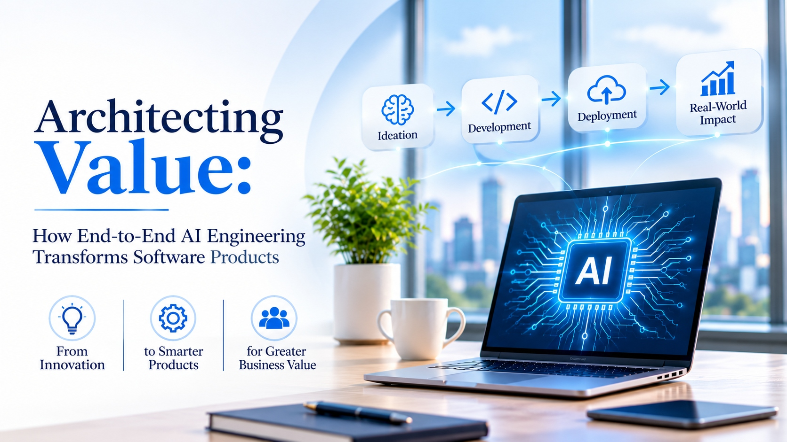

# Architecting Value: How End-to-End AI Engineering Transforms Software Products



A software product is more than the model inside it. Before any production code is written, someone has to decide what value the product creates, how that value will be proven, and who is accountable for it. This workbook is built around those decisions.

Teams that treat AI as part of the whole product, through [end-to-end AI product engineering](https://zignuts.com/ai-services/custom-ai-development/ai-product-engineering-services?utm_source=seo_web2.0&utm_medium=backlink&utm_campaign=seo_referral&utm_id=11), write those decisions down early and revisit them at every stage of the build.

Use the templates below as working documents, not finished answers. Replace the brackets with your own product, users, and numbers.

---

## Write the Value Hypothesis

```
We believe that [capability] for [user]
will improve [measure] from [baseline] to [target]
because [reason].
We will know within [period] if [evidence].
```

If you cannot fill every bracket, the product is not ready to build.

## Stage Gates

| Gate | Question to answer | Evidence to bring |
|---|---|---|
| **1. Frame** | Is the problem worth solving? | A baseline and a named owner |
| **2. Prove the data** | Is the information reliable enough? | Source list, quality checks, access rules |
| **3. Thin slice** | Does a small version create value? | Results from real users |
| **4. Integrate** | Does it fit real workflows? | Connected systems and handled failures |
| **5. Release** | Is it safe to widen access? | Security review, monitoring, rollback plan |
| **6. Learn** | Is it still worth the cost? | Review against the baseline |

## Who Owns What

| Role | Owns |
|---|---|
| **Business owner** | The outcome and adoption |
| **Product lead** | Scope and priorities |
| **Engineering lead** | Architecture, integration, reliability |
| **Data lead** | Quality, ownership, and access |
| **Risk and security** | Controls proportionate to the risk |

## Build, Buy, or Partner

| Option | Choose it when | Watch for |
|---|---|---|
| **Build** | The capability is a core advantage | Time, skills, and upkeep |
| **Buy** | A standard product already fits | Lock-in and limits on customizing |
| **Partner** | You need skills or speed you lack | Knowledge staying with the partner |

## Risks to Watch

- A model that performs well but is never used
- Data that looks ready until real records arrive
- An integration that adds manual steps instead of removing them
- Costs that grow faster than the value created
- Security review that begins after the build

## Readiness Checklist

- [ ] The value hypothesis is complete and agreed
- [ ] A baseline is recorded
- [ ] Each gate has an owner and evidence
- [ ] The first release is a thin slice, not the full vision
- [ ] Monitoring and rollback exist before launch

---

**Ready to engineer a product that delivers value?** Visit [zignuts.com](https://zignuts.com/?utm_source=seo_web2.0&utm_medium=backlink&utm_campaign=seo_referral&utm_id=11) to speak with the team.
